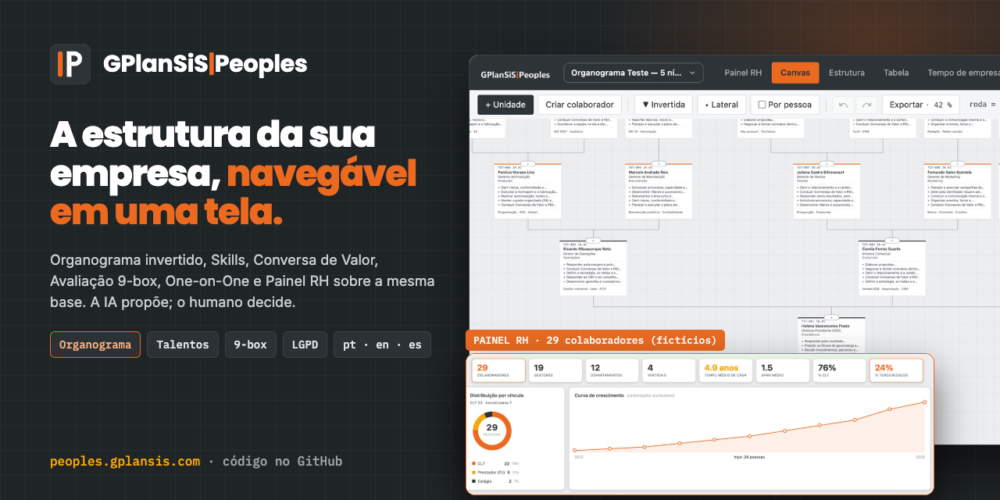
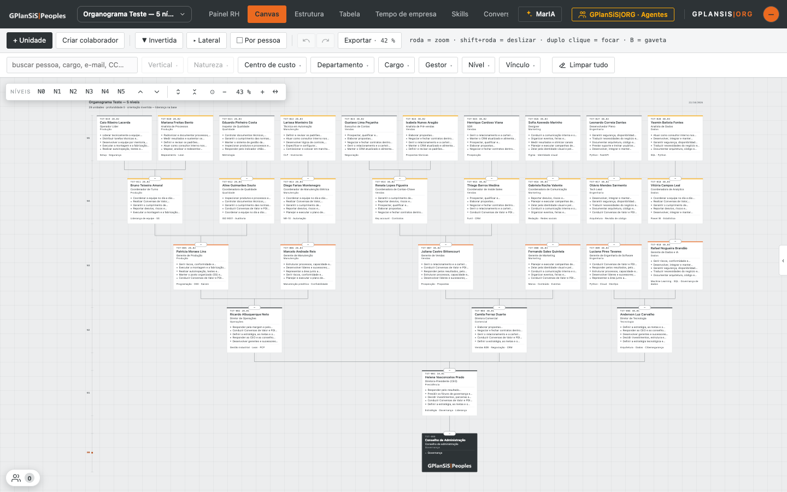
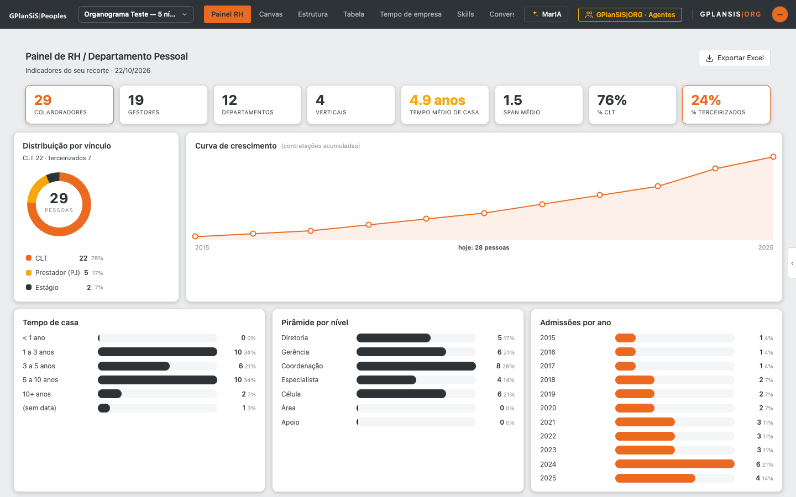
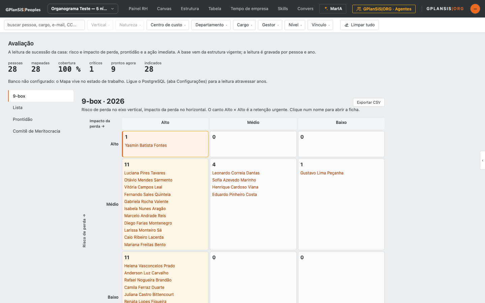
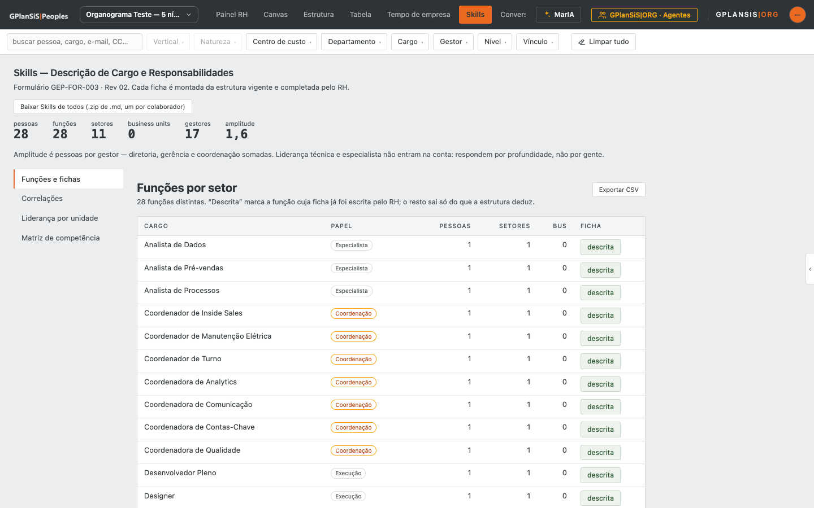
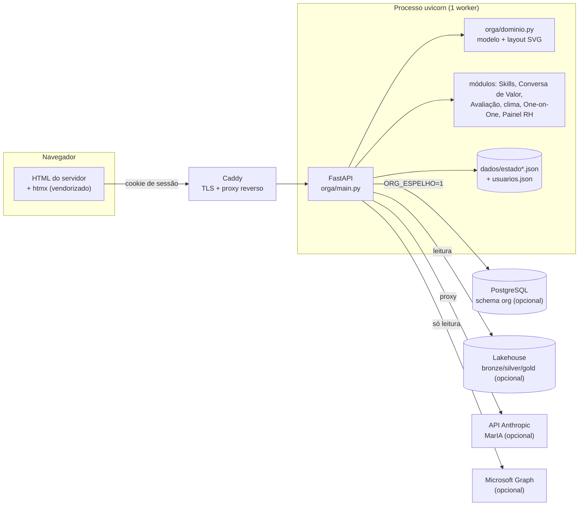

<p align="center">
  <a href="https://peoples.gplansis.com"></a>
</p>

<h1 align="center">GPlanSiS|Peoples</h1>

<p align="center">
  <strong>Gestão organizacional, performance e talentos: organograma invertido navegável, Skills, Conversa de Valor, Avaliação 9-box, pesquisa de clima, One-on-One e Painel RH sobre a mesma base.</strong><br>
  A IA propõe; o humano decide.
</p>

<p align="center">
  <a href="https://peoples.gplansis.com"></a>
  
  <a href="LICENSE"></a>
  
  
  
  
  <a href="CONTRIBUTING.md"></a>
</p>

<p align="center">
  <a href="https://peoples.gplansis.com"><b>➜ Abrir o GPlanSiS|Peoples em peoples.gplansis.com</b></a>
</p>

---

## O que é

O **GPlanSiS|Peoples** é o sistema de pessoas do hub GPlanSiS. No centro está um **organograma invertido**: a liderança fica na **base**, sustentando, e os times crescem para cima — e, quando a pergunta muda, a mesma árvore gira para a orientação **lateral** ou clássica. O canvas é clicável e editável, com gaveta lateral, filtros que se filtram uns aos outros, tabela editável, exportação em **PDF A3 vetorial** e um ciclo de planilha que **volta**: o XLSX exportado é o mesmo que a carga assistida lê.

Sobre a estrutura roda uma suíte de **gestão de talentos** — Skills (descrição de cargo), Conversa de Valor (feedback em três ciclos com PDI), Avaliação (9-box de risco × impacto, prontidão de sucessão e Comitê de Meritocracia), pesquisa de clima anônima e One-on-One —, um **Painel RH** com os indicadores de gente e a assistente **MarIA**, que lê a estrutura no recorte de quem pergunta. Tudo com RBAC, sigilo por pessoa e trilha de auditoria hash-encadeada.

O servidor monta o HTML (FastAPI + Jinja + htmx vendorizado): sem SPA, sem etapa de build, sem CDN no app. Roda em memória com persistência em JSON e, opcionalmente, espelha cada gravação no **PostgreSQL**.

## Funcionalidades

### Organograma
- **Três orientações** — invertida (liderança na base), lateral (árvore indentada para a direita) e clássica — com níveis N0…N5, zoom, foco por duplo clique e visita guiada.
- **Por pessoa ou por equipe**: agrupa pelo centro de custo/departamento sem perder quem lidera.
- **Filtros encadeados** (vertical, natureza, centro de custo, departamento, cargo, gestor, nível, vínculo) com busca e pílulas do recorte.
- **Vistas**: Canvas, Estrutura (funil institucional Cliente → Business Units → Serviços Compartilhados → Diretoria), Tabela editável e Tempo de empresa.
- **Multi-organograma**: vários organogramas no mesmo servidor, cada um com estado próprio.

### Talentos e pessoas
- **Skills** — descrição de cargo e responsabilidades por função, matriz de competência, liderança por unidade e correlações; exporta `.zip` de fichas.
- **Conversa de Valor** — conversas de desenvolvimento em três ciclos (completa e dois check-ins), aderência a valores, PDI 70/20/10 e feedback à liderança; ficha em PDF.
- **Avaliação** — 9-box de risco × impacto de perda, lista, prontidão de sucessão e Comitê de Meritocracia.
- **Pesquisa de clima** — anônima, cinco pilares, publicação só a partir do piso de respondentes.
- **One-on-One** — 1:1/FUP, rocks e issues no estilo EOS, alertas de burnout e missões; sigilo por pessoa.
- **Painel RH** — colaboradores, gestores, tempo médio de casa, span, vínculos, pirâmide por nível, admissões por ano; exporta Excel.

### Carga, exportação e integração
- **Carga assistida de planilha** (XLSX) com leitura por título de coluna, conciliação de quem é quem entre cargas e prévia antes de aplicar; **modelo XLSX** para download.
- **PDF A3 paisagem** vetorial do organograma, **XLSX** de ida e volta, SVG e CSV.
- **Cadastros**: centros de custo (N2/N3/N4, vertical, natureza), cargos e níveis, provisionamento de TI por equipe, diretório social.
- **Microsoft 365** (opcional): sincronização de centro de custo via Microsoft Graph, só leitura.
- **Lakehouse**: API `GET /api/v1/lake/*` para máquina a máquina com tokens de serviço; ETL e schema em [`deploy/lakehouse/`](deploy/lakehouse).
- **E-mail (SMTP)** opcional para avisos do provisionamento.

### Plataforma
- **Login próprio**: e-mail + senha com hash **scrypt**, JWT HS256 em cookie HttpOnly, freio a força bruta, senha temporária com troca obrigatória, primeiro administrador pela tela de login.
- **RBAC** por organograma com escopo de leitura (próprio, subárvore, tudo); `ORG_SUPERADMINS` entra como administrador total.
- **Ledger hash-encadeado** de todas as mutações, com verificação de integridade (`/api/v1/auditoria/verificar`) e histórico com desfazer.
- **PostgreSQL** opcional (`ORG_DATABASE_URL` + `ORG_ESPELHO=1`): estrutura, ledger, módulos e credenciais descem para o banco; o JSON continua sendo a queda.
- **Três idiomas** (pt-BR, en-US, es), tema escuro e layout para celular.

### MarIA (opcional)
- Assistente com o **Claude** (Anthropic): lê a estrutura no recorte de quem pergunta, guia o passo a passo e propõe ações. **Toda mutação proposta exige aprovação humana**, por ação. Sem `ANTHROPIC_API_KEY`, o módulo abre e explica o que faria.

## Telas

| Organograma invertido | Painel RH |
|---|---|
|  |  |
| **Avaliação — 9-box** | **Skills — descrição de cargo** |
|  |  |

> Capturas feitas numa instância local com o **organograma de teste** gerado por `ferramentas/organograma_teste.py`: 28 pessoas **fictícias**. Nenhum dado real de colaboradores acompanha este repositório.

## Arquitetura



- **Um processo, um estado**: o estado vive em memória e é gravado em `dados/`; por isso o uvicorn roda com 1 worker.
- O layout do organograma é calculado **no servidor** e entregue como SVG; o PDF A3 sai do mesmo desenho.
- Em produção roda em venv + systemd atrás do Caddy, com o PostgreSQL do host por socket Unix ([`deploy/README.md`](deploy/README.md)). O `Dockerfile` e o `docker-compose.yml` servem a quem desenvolve ou roda fora do hub.
- As decisões de projeto estão explicadas em [`docs/DECISOES.md`](docs/DECISOES.md).

## Stack

| Camada | Tecnologia |
|---|---|
| Frontend | HTML renderizado no servidor (Jinja2), htmx 2.0.4 e AG Grid Community vendorizados, SVG, sem build |
| Backend | Python 3.12, FastAPI, uvicorn, openpyxl, Pillow |
| Persistência | JSON em `dados/` + PostgreSQL opcional (`psycopg`) |
| IA | API da Anthropic (Claude) — MarIA |
| Testes | pytest + httpx (~1 150 testes) |
| Implantação | systemd + Caddy, ou Docker / Docker Compose |

## Como rodar localmente

Requisitos: Python 3.12+ (testado também com 3.14).

```bash
git clone https://github.com/SSBianchiplan/peoples.git
cd peoples
python3 -m venv .venv
.venv/bin/pip install -r requirements.txt

# base de demonstração 100% fictícia (gravada em dados/, que não vai para o Git)
.venv/bin/python ferramentas/organograma_teste.py     # organograma de teste: 28 pessoas, 5 níveis
.venv/bin/python ferramentas/gerar_skills.py          # fichas de Skills dos cargos
.venv/bin/python ferramentas/gerar_ciclo_pessoas.py   # Conversas de Valor, avaliações e clima fictícios

.venv/bin/uvicorn orga.main:app --port 8080
```

Abra <http://localhost:8080> e escolha **Organograma Teste — 5 níveis** no seletor do cabeçalho. Sem `.env`, o sistema sobe **aberto** (sem login) — o modo de trabalho de mesa.

- Para exigir login: copie `.env.exemplo` para `.env`, defina `ORG_EXIGIR_LOGIN=1` e um `JWT_SECRET` de 32+ caracteres (`python -c "import secrets; print(secrets.token_hex(32))"`). Sem usuários, `/login` oferece criar o administrador inicial.
- Em `http://localhost` deixe `ORG_COOKIE_SEGURO` vazio; em produção (HTTPS) use `1`.
- Para usar a sua estrutura: **Configurações › Carga assistida** com uma planilha no formato de `/modelo.xlsx`.
- Testes: `.venv/bin/python -m pytest -q`.

### Com Docker

```bash
cp .env.exemplo .env          # preencha; POSTGRES_PASSWORD é obrigatório
docker compose up -d --build  # app em http://127.0.0.1:8400, com PostgreSQL
```

## Estrutura de pastas

```
peoples/
├── orga/                   # o app (um pacote, um módulo por assunto)
│   ├── main.py             # FastAPI: rotas, vistas, fragmentos htmx
│   ├── dominio.py          # modelo + motor de layout do organograma
│   ├── dcr.py · cgv.py · talentos.py · gptw.py · onebyone.py · painel_rh.py
│   ├── importador.py       # carga assistida de planilha
│   ├── pdf.py · exportador_rh.py · relatorio.py
│   ├── acesso.py · usuarios.py   # sessão, RBAC, credenciais
│   ├── banco.py · lake.py · m365.py · maria.py · idiomas.py …
│   └── schema.sql          # schema PostgreSQL (org.*)
├── web/
│   ├── templates/          # HTML Jinja
│   ├── marca/              # logo, ícones, MarIA
│   ├── publico/landing.html
│   └── vendor/             # htmx, AG Grid (+ licenças)
├── ferramentas/            # geradores da base fictícia, Skills, marca, ETL do lake
├── testes/                 # suíte pytest
├── deploy/
│   ├── vps/                # instalar.sh, enviar.sh, systemd e Caddy
│   ├── migracoes/          # SQL idempotente 001–011
│   └── lakehouse/          # schema e instalador do lakehouse
├── docs/                   # DECISOES.md, SPEC, páginas servidas pelo app
├── Agentes/                # página dos agentes GPlanSiS|ORG (/agentes)
├── Dockerfile · docker-compose.yml
└── .env.exemplo
```

## Variáveis de ambiente

| Variável | Uso |
|---|---|
| `JWT_SECRET` | Segredo da sessão (32+ caracteres; obrigatório com login) |
| `ORG_EXIGIR_LOGIN` | `1` fecha o sistema atrás do login |
| `ORG_COOKIE_SEGURO` | `1` marca o cookie como `Secure` (HTTPS) |
| `ORG_DOMINIOS` | Domínios de e-mail aceitos no login (lista) |
| `ORG_EMAIL_EXEMPLO` | E-mail de exemplo mostrado na tela de login |
| `ORG_SUPERADMINS` | E-mails que entram como administrador total (padrão `contato@gplansis.com`) |
| `ORG_ADMIN_EMAIL` · `ORG_ADMIN_SENHA` | Administrador inicial no primeiro arranque |
| `ORG_USUARIOS_ARQUIVO` | Caminho do arquivo de credenciais (padrão `dados/usuarios.json`) |
| `ORG_IDIOMA` | Idioma de abertura: `pt-BR`, `en-US` ou `es` |
| `ORG_PORT` | Porta do uvicorn/healthcheck |
| `ORG_DATABASE_URL` · `ORG_ESPELHO` | PostgreSQL e espelhamento de toda gravação |
| `LAKE_LEITOR_DSN` · `ORG_LAKE_TOKENS` | Leitura do lakehouse e tokens da API `/api/v1/lake` |
| `ANTHROPIC_API_KEY` · `MARIA_MODEL` | MarIA (Claude) e modelo padrão |
| `AZURE_TENANT_ID` · `AZURE_CLIENT_ID` · `AZURE_CLIENT_SECRET` · `CC_ATTRIBUTE` | Sincronização com o Microsoft 365 |
| `SMTP_HOST` · `SMTP_PORTA` · `SMTP_USUARIO` · `SMTP_SENHA` · `SMTP_DE` · `SMTP_NOME` · `SMTP_SSL` | E-mail |
| `LANGUAGETOOL_URL` | Servidor LanguageTool para revisão de texto (opcional) |
| `POSTGRES_USER` · `POSTGRES_DB` · `POSTGRES_PASSWORD` | Só para o `docker-compose.yml` |

Modelo comentado em [`.env.exemplo`](.env.exemplo). Nunca versione o `.env`.

## Contribua

O Peoples quer ser a ferramenta de pessoas que um RH de verdade usa todo dia — leve, auditável e respeitando a LGPD. **Toda ajuda conta**, de uma tradução a um módulo novo.

**Por onde começar (boas primeiras issues):**
- 🌐 **Idiomas**: revisar as traduções en-US e es de `orga/idiomas.py` ou propor um quarto idioma.
- 🧪 **Testes** para cantos ainda descobertos: carga assistida com planilhas estranhas, escopo de leitura por papel, PDF A3 com árvores grandes.
- ♿ **Acessibilidade** do canvas: navegação por teclado, leitores de tela, contraste no tema escuro.
- 📱 **Celular**: refinar gestos e gaveta em telas pequenas.
- 📥 **Importadores**: modelos de planilha de outros sistemas de folha/RH (sem dados reais nos exemplos!).
- 📊 **Painel RH**: novos indicadores (turnover, diversidade agregada com piso de amostra).
- 🧩 **Organogramas de exemplo** fictícios em outros setores para `ferramentas/`.
- 📚 **Documentação**: tutoriais de uso, guia de implantação com Docker.
- 🛠️ **CI**: lint (ruff) no workflow existente.

Leia o [guia de contribuição](CONTRIBUTING.md), abra uma [issue](../../issues/new/choose) para combinar a ideia e mande seu pull request. Siga o [código de conduta](CODE_OF_CONDUCT.md). Encontrou uma falha de segurança ou de privacidade? Veja a [política de segurança](SECURITY.md) — não abra issue pública.

## Licença

Código próprio sob a **[licença MIT](LICENSE)** — Copyright (c) 2026 GPlanSiS.

Componentes de terceiros incluídos em [`web/vendor/`](web/vendor/LICENCAS-TERCEIROS.md): **htmx 2.0.4** (0BSD) e **AG Grid Community 32.3.3** (MIT). Dependências Python instaladas por `pip`: FastAPI (MIT), uvicorn (BSD-3-Clause), Jinja2 (BSD-3-Clause), python-multipart (Apache-2.0), openpyxl (MIT), Pillow (MIT-CMU), psycopg (LGPL-3.0, usada como biblioteca), pytest (MIT), httpx (BSD-3-Clause). A landing pública carrega as fontes Poppins, Inter e IBM Plex Mono do Google Fonts (SIL OFL 1.1).

## Créditos

Desenvolvido pela **[GPlanSiS|Group](https://gplansis.com)** · contato: [contato@gplansis.com](mailto:contato@gplansis.com)

<p align="center"><a href="https://peoples.gplansis.com"><b>peoples.gplansis.com</b></a></p>
